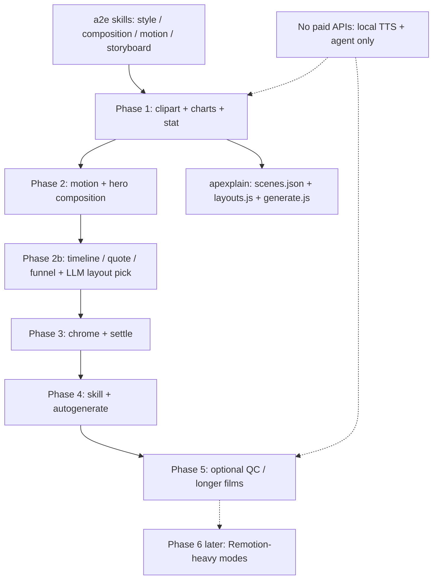

# Improve apexplain visuals from anything2explainer

## Verdict

[anything2explainer](https://github.com/Vincentwei1021/anything2explainer) is stronger at **motion-graphics storytelling** (hero-sized line art, chart cards, draw-on diagrams, HUD/progress chrome, composition rules). Apexplain is stronger at **agent cost** (one ~2KB skill, five layouts, single `make`). The boring look comes from text cards + Lucide strokes + opacity-only fades—not from missing Remotion.

**Approach (locked):** stay on `@napi-rs/canvas` + declarative `scenes.json`. Port *ideas* from a2e’s skill/reference docs into new layouts, primitives, motion, and autogenerate rules. Do **not** vendor a2e’s Remotion template or UI code ([PolyForm Noncommercial](https://github.com/Vincentwei1021/anything2explainer/blob/main/LICENSE)); reimplement under apexplain’s MIT.

**Cost stack (locked):** no paid services or API keys in the product path. Default stack = **local** (Kokoro / Vocello as today, canvas render, ffmpeg) **or free Edge TTS if ever added as an optional free engine**, plus **the user’s existing agent subscription**. Explicitly out: Volcengine, ElevenLabs, Cartesia, OpenRouter clips, Remotion Cloud, generative video APIs, or any metered cloud TTS/vision/QC. Soft limits (Edge rate/ToS, agent token burn, disk) are acceptable; billed keys are not.

## Gap map (what a2e does better)

| Area | anything2explainer | apexplain today | Leverage? |
|------|--------------------|-----------------|-----------|
| Clipart / icons | Topic SVG primitives (`DocIcon`, `DBIcon`, funnel, etc.) in `ui.tsx` | Named canvas clipart + Lucide accents | **Done — Phase 1** |
| Graphs | Chart cards (grid + curve + highlight) in style guide | `chart` bar/line/pie | **Done — Phase 1** |
| Big numbers | `BigNumber` / Orbitron count-up | `stat` + count-up motion | **Done — Phase 1–2** |
| Composition | Hero ≥1/3 frame; one focus; size tiers | Hero sizing + clipart cards | **Done — Phase 2** |
| Motion | SoftIn, draw-on, stagger, counters | SoftIn / stagger / draw-on / count-up + JSON `motion` | **Done — Phase 2** |
| a2e §4 shot relations (canvas-fit) | Custom Remotion shots per relation | `timeline`, `quote`, `funnel` + steps/flow/compare/stat/chart | **Done — Phase 2b** |
| Chrome | Chapter progress, HUD, pipeline rail | Optional captions + SRT | **Selective — Phase 3** |
| Storyboard skill | Shot patterns by relation; narration guidance | Context layoutHints + decision table; more polish left | **Phase 4** |
| Research + sourced facts | Research brief + URL checklist | “Never invent numbers” only | **Light — Phase 4** |
| Remotion-heavy modes | Point cloud, tilt planes, network, formula tokens, LightSweep | Approximate with existing layouts + clipart | **Later — Phase 6** |
| Multi-agent Remotion build + frame QC | Full 9-stage pipeline | Single-process make | **No / Phase 5 light QA only** |
| Black MG look + purple accents | Fixed brand look | `studio` / `dark` + subtle backdrops | Keep apexplain themes |

Primary code touchpoints: [`src/layouts.js`](src/layouts.js), [`src/scenes.js`](src/scenes.js), [`src/clipart.js`](src/clipart.js), [`src/motion.js`](src/motion.js), [`src/theme.js`](src/theme.js), [`src/generate.js`](src/generate.js), [`skills/apexplain/SKILL.md`](skills/apexplain/SKILL.md).

---

## Phase 1 — Clipart, charts, and stats (fixes “no clipart nor graphs”)

**Status:** completed.

**Goal:** Declarative visuals that feel illustrated, not like a slide deck of text boxes.

1. **Clipart registry** (`src/clipart.js`, canvas Path2D—not Lucide).
2. **New layouts:** `stat`, `chart` (+ schema/QA + `examples/charts-demo`).

**Exit:** `make` renders hero clipart, chart, and big-number scenes without agent-written canvas code.

---

## Phase 2 — Motion + composition (fixes “boring”)

**Status:** completed.

**Goal:** SoftIn / stagger / draw-on / hero-size / settle hold + declarative `video.json` / `scenes.json` `motion`.

**Exit:** Larger heroes, animated reveals, non-flat backgrounds; no Remotion dependency.

---

## Phase 2b — a2e §4 canvas layouts + context layout pick

**Status:** completed.

Port the a2e storyboard “画面关系” modes that fit canvas without Remotion:

| a2e relation | Apexplain layout | Clipart hint |
| --- | --- | --- |
| Ordered process | `steps` / `flow` | `gear`, `cycle` |
| Cause→effect / merge / pipeline | `flow` | `nodes`, `stack` |
| Filter / narrow / screen-out | `funnel` | `funnel` |
| Two sides / tradeoff | `compare` | per-side clipart |
| Parts of a subject | `cards` | subject metaphor |
| Big number | `stat` | `bars` |
| Trend / comparable magnitudes | `chart` | — |
| Time axis / history | `timeline` | — |
| Source / takeaway line | `quote` | `book` |
| Open / close hook | `title` (close may be `quote`) | hero clipart |

Autogenerate outline now carries `relation` + `layoutHints`; the LLM picks by beat content (not round-robin). Forced outline remapping only repairs invalid layouts.

**Exit:** Autogenerate can emit mixed `steps`/`flow`/`funnel`/`timeline`/`quote`/`stat`/`chart`/`compare` with motion blocks.

---

## Phase 3 — Lightweight chrome

**Goal:** Optional structure cues without a2e’s full HUD/pipeline system.

**Status: completed** (shipped after v0.0.6).

1. Optional `video.json` flags: `progress: true`, `chapters: ["Intro","Orbit","Fix"]` (or derive from `storyboard.md` `##` headings) — implemented in [`src/project.js`](src/project.js) + [`src/chrome.js`](src/chrome.js); UI has a **Progress strip** checkbox and a **Chapters** field.
2. Bottom chapter/progress strip drawn in [`src/render.js`](src/render.js) via `drawProgressChrome` — lives *below* the safe area, so scene content stays clear.
3. Stronger burned-in caption styling (rounded scrim + hairline edge + soft shadow) in [`src/captions.js`](src/captions.js); captions lift above the strip via `bottomInset`.

**Exit:** 16:9 and 9:16 renders keep content clear of progress + captions; default remains chrome-off for token/MVP simplicity.

---

## Phase 4 — Skill + autogenerate (make the agent pick rich visuals)

**Goal:** Autogenerate and agents stop defaulting to text cards. (Partially done in 2b; finish polish here.)

1. Update [`src/generate.js`](src/generate.js):
   - Harden keyword → clipart suggestions; expand beyond fixed Lucide icons.
   - Prompt/docs: one visual hero per scene; prefer `funnel`/`timeline`/`quote` when relation matches.

2. Compact **on-demand** docs (keep SKILL.md small):
   - `apexplain docs visuals` — layout catalogue + clipart/chart schemas + composition one-pager.
   - Optional `apexplain docs narration` — short beats from a2e `narration-guidance`.

3. SKILL.md: keep decision table + motion recipes in sync with layouts.

**Exit:** Autogenerate on a numeric/how-it-works topic yields mixed rich layouts with clipart, not three `cards` scenes.

---

## Phase 5 — Selective process upgrades (only if needed)

Keep apexplain’s single-agent `make` loop. Add only if Phase 1–4 still feel thin for longer videos:

- Optional `--preview-seconds 15` still sheet for a human look check (a2e checkpoint 4, simplified).
- Lightweight frame metrics (max object height / empty-frame heuristic) as optional `make --qa`—inspired by a2e `frame_metrics.py`, not a vision-agent QC farm.
- Research checklist stub (`research.md` links for on-screen numbers)—not a multi-agent Remotion build.

**Still out of product path:** Remotion rewrite as default, parallel shot agents, cloning the black-MG brand, **any paid TTS/video/vision API**, Remotion Cloud, or metered QC services.

---

## Phase 6 — Remotion-heavy presentations (later)

**Status:** deferred. Do **not** start until Phases 3–5 are decided/done and product still wants these looks.

These a2e §4 modes need depth, particle fields, or multi-layer FX that fight the token-cheap canvas MVP. Until then, approximate with Phase 2b layouts + clipart; do **not** invent Remotion-only JSON fields.

| Mode | a2e idea | Why deferred | Canvas stand-in today |
| --- | --- | --- | --- |
| Point cloud / proximity | Grid plane + neighbor rings | Dense particles + push camera | `cards` / `chart` + `nodes` |
| Tilted layers / depth | Skew/perspective stacks + path draw-on | True perspective stack | `flow` / `stack` clipart |
| Network / relation graph | Node light-up + edge draw-on + communities | Graph layout + timed edges | `flow` + `nodes` |
| Formula token stream | Per-token reveal + result emphasis | Token timing + math layout | `quote` / `steps` |
| LightSweep set-pieces | Sweep + stage line + ghost text (≤2/film) | Multi-pass FX + budget whitelist | `title` SoftIn + accent bar |

**Possible exit (when started):** either (a) richer canvas approximations that stay declarative, or (b) an **opt-in** Remotion export path that never becomes the default `make`—still MIT-clean reimplementation, no a2e template copy, no paid Remotion Cloud.

---

## Implementation order and risk

- Phase 1–2b shipped—clipart/graphs/motion + canvas a2e relations.
- Phase 3–4 next for chrome and agent consistency.
- Phase 5 only if longer films need light QA.
- Phase 6 only if stand-ins remain insufficient; keep canvas default and cost lock.
- Preserve token-MVP: agents still write JSON, never shot React; new docs are `docs <id>` on demand only.
- Preserve cost lock: every phase ships with local/free tooling only; do not introduce connectors that need a user-supplied paid key.
