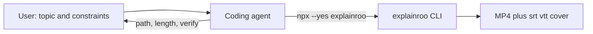
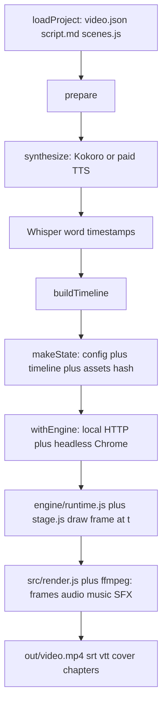
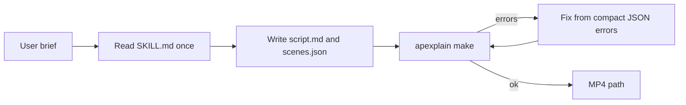

# Apexplain: explainroo journey, flow, and a token-cheap MVP

Map explainroo’s agent-driven user journey and render pipeline, then specify Apexplain as a new, slimmer studio in this repo: same script-then-pictures idea, but a tiny skill, declarative layouts, and one `make` command so agents spend far fewer tokens.

## Implementation todos

- [ ] Scaffold Apexplain CLI: init, docs, make --dry-run (parse + schema + duration estimate)
- [ ] Define scenes.json schema (5 layouts) and compact JSON errors; parse script.md subset
- [ ] Implement TTS cache, sentence timeline, layout engine, ffmpeg mux for 16:9 and 9:16
- [ ] Write a ~2KB SKILL.md plus one-line AGENTS.md; port leap-years as the golden example
- [ ] Add a test that invalid scenes fail with path+fix, and a valid project produces an MP4

## What explainroo is

[explainroo](https://github.com/vincentsch/explainroo) (v0.6.2) is not a GUI. The **user** talks to a coding agent; the **agent** runs a CLI. Two project files become a narrated MP4:

- [`script.md`](https://github.com/vincentsch/explainroo/blob/main/templates/starter/script.md) — spoken words, scene ids, markers
- [`scenes.js`](https://github.com/vincentsch/explainroo/blob/main/templates/starter/scenes.js) — one function per scene that draws on a canvas API (`s.title`, `s.box`, `at: 'word'` / `'#marker'`)
- `video.json` — theme, size, voice, captions, watermark, budgets

Local stack: **Kokoro TTS → Whisper word times → Chrome (Playwright) draws frames → ffmpeg mux** with generated music/SFX. Optional paid paths (OpenRouter images/clips, ElevenLabs/Cartesia, YouTube/Buffer/Blotato) only run when the agent invokes them.

---

## User experience journey

The human never opens a studio. Their journey is:



**1. Prompt.** README tells them to paste: *Make me a short explainer about [topic]. Use explainroo: run `npx --yes explainroo docs` and follow it.* Best with Claude Code / Opus 5.5.

**2. Agent setup.** `doctor --fetch` (~860 MB English models, plus Node 20.11, ffmpeg, Chrome). Agent is told to decide look/length/voice itself and ask only when blocked (unclear facts, paid keys, camera footage).

**3. Project.** `init videos/<name> --theme studio --size 16:9 --title "..."`. Starter is intro / main / outro.

**4. Script first.** Agent writes `script.md` (45–120s, ~165–200 wpm). Markers `[#cue]`, `{shown|spoken}`, `[pause]`. Timing of pictures is bound to speech.

**5. Voice.** `voice` synthesizes per scene, Whisper aligns words, speech-check loops on `{shown|spoken}`. Incremental: only changed scenes rebuild.

**6. Pictures.** Agent plans layout, optionally `image`/`clip` (paid), writes `scenes.js` against a large scene API.

**7. Agent QA (expensive).** `check` → `still` / `sheet` (agent *opens images* and judges like a viewer) → fix → `render` → `verify` (loudness, black frames, mix vs voice). Draft render is discouraged; stills are cheaper than full encode.

**8. Handoff.** Agent reports file paths, duration, verify verdict. `package` / `publish` / `share` only if the user asked.

**Token-heavy loops today:** dump `AGENTS.md` (~12 KB) plus many `docs` topics (`scene-api` ~24 KB, `product-demos` ~24 KB, `publishing` ~24 KB); write JS against a huge API; `words` + still/sheet vision passes; pronunciation retry; troubleshooting.md on every layout warning.

---

## Program flow

CLI entry: [`bin/explainroo.js`](https://github.com/vincentsch/explainroo/blob/main/bin/explainroo.js) → [`src/cli.js`](https://github.com/vincentsch/explainroo/blob/main/src/cli.js). Shared pipeline is [`src/pipeline.js`](https://github.com/vincentsch/explainroo/blob/main/src/pipeline.js).



**`prepare`:** fonts → `synthesize` → `buildTimeline` → `build/timeline.json`.

**`makeState`:** hashes `scenes.js`, look, assets, config; injects into the engine page (the page does not read project JSON itself).

**`withEngine`:** tiny static server + Playwright Chrome; `still`/`sheet`/`check`/`render` all reuse this.

**Engine:** [`engine/stage.js`](https://github.com/vincentsch/explainroo/blob/main/engine/stage.js) (large drawing API), [`engine/director.js`](https://github.com/vincentsch/explainroo/blob/main/engine/director.js) (camera that tracks spoken cues), captions, Rough.js, Lucide icons, MathJax, code steps, recordings.

**Identity / cache:** `renderIdentity` hashes scenes + engine so stale MP4s are detected; voice is cached separately so engine upgrades do not re-TTS.

**Not in the MVP:** `record`/`capture` product demos, `cut`, AI clips/images, presenters, OAuth publish, 7 themes × many sizes, motion blur (6 samples/frame), web player, formats marketplace.

---

## Apexplain MVP (between a new app and a slim fork)

**Product choice:** new codebase in this **Apexplain** repo. Copy *ideas and a few small files* (script grammar, timeline math, ffmpeg mux), **not** the 160 KB `stage.js` / 110 KB `runtime.js` / 40+ CLI commands. MIT-compatible inspiration; do not vendor the whole tree.

**Success metric:** a coding agent can ship a 45–60s English explainer after reading **one skill under ~2 KB**, writing **one JSON (or YAML) scene file**, and running **`apexplain make <dir>`** — no `docs scene-api`, no `words`, no still/sheet vision loop.

### Token budget design (priority)

| explainroo cost | Apexplain cut |
| --- | --- |
| AGENTS.md + 20 doc topics in context | One `skills/apexplain/SKILL.md`: init → write script+scenes → `make`. Extra docs only if `make` prints `read: apexplain docs <id>` |
| Agent writes `scenes.js` against a huge canvas API | Agent fills a **schema**: `layout: cards \| steps \| compare \| flow \| title` + slot text/icons; engine maps to drawing |
| 11 CLI steps + still/sheet review | `make` = voice + layout-check + render; JSON errors with file:line, not a troubleshooting essay |
| Cue every spoken word via Whisper + `words` | Cues are **scene start / sentence index / `#marker` only**; sentence times from TTS duration + pause rules (Whisper optional later) |
| Agent opens PNGs | Layout check is geometric (overflow, overlap, min type size). Vision is out of MVP |
| Pronunciation retry loop | `{shown\|spoken}` supported; skip speech-to-text confirm in MVP (biggest token + time saver) |

### Agent loop (target)



### Project shape

```
videos/demo/
  video.json          # title, size 16:9|9:16, theme studio|dark
  script.md           # same ## scene-id grammar as explainroo starter
  scenes.json         # declarative layouts, not JS
  out/video.mp4
```

Example `scenes.json` (agent-sized, not a drawing API):

```json
{
  "intro": { "layout": "title", "title": "Why leap years exist", "subtitle": "Calendars vs Earth's orbit" },
  "orbit": {
    "layout": "steps",
    "cue": "sentence",
    "items": [
      { "icon": "globe", "text": "365.2422 days per orbit" },
      { "icon": "calendar", "text": "365 days on the calendar" },
      { "icon": "clock", "text": "Drift of ~0.24 day per year" }
    ]
  }
}
```

`cue: "sentence"` reveals item *i* when sentence *i* starts. `#marker` in the script can override. No per-word `at`.

### Runtime (slim, keep working locally)

Keep explainroo’s *shape*, shrink the *surface*:

1. **Parse** `script.md` (subset: `## id`, `[#m]`, `[pause]`, `{shown|spoken}`).
2. **TTS** — still Kokoro for quality (user chose token savings, not 860 MB cuts). Cache per scene. Estimate length from letters/sec before TTS so the agent can trim the script without synthesizing.
3. **Timeline** — scene lead/hold + sentence pauses; map cues to sentence start times (no Whisper in MVP).
4. **Render** — one small HTML canvas or SVG engine with **five layouts only**, Lucide icons subset, one type scale, no camera director / Rough.js / MathJax / recordings.
5. **ffmpeg** — voice + optional simple bed + hard-burn captions for 9:16.
6. **CLI:** `init`, `make`, `preview` (optional live reload), `docs <id>`, `--json`.

Do **not** implement: publish, record, capture, AI image/clip, 54-voice catalog in the skill, multi-language, motion blur, `check` on arbitrary MP4s.

### Skill file (the actual token product)

[`skills/apexplain/SKILL.md`](../skills/apexplain/SKILL.md) should fit in one screen:

- When to use; command prefix `npx --yes apexplain` (or `node bin/apexplain.js`).
- Exact `init` + file names + 5 layouts with 4-line examples.
- Script rules: 45–90s, 8–18 word sentences, one idea per scene, `#markers` optional.
- `make --json`; on error, edit the cited field; do not read other docs unless the error says so.
- Never invent numbers; ask once if the topic is empty.

[`AGENTS.md`](../AGENTS.md) is a one-line pointer to the skill (avoid duplicating 12 KB).

### Implementation order in this repo

1. Scaffold Node CLI (`bin/apexplain.js`, `src/cli.js`) with `init` / `docs` / `make --dry-run` (parse + schema validate + duration estimate, no TTS).
2. Script parser + `scenes.json` schema (AJV or hand-rolled) + compact errors.
3. Timeline from estimated speech (letters/sec) then swap in Kokoro when `make` is real.
4. Five layout renderers + Playwright/Chrome **or** a single-process canvas if we can avoid Chrome later; start with Chrome for fidelity, one theme, 16:9 + 9:16.
5. ffmpeg mux + captions.
6. Skill + a `examples/leap-years` port using `scenes.json` (proof that an agent can describe a real explainer without JS).
7. A golden test: `make examples/leap-years` exits 0 and writes `out/video.mp4`; invalid scenes.json prints JSON with `path` + `fix`.

### Explicit non-goals for v1

Forking explainroo; matching frame-for-frame look; agent vision QA; Whisper; paid connectors; product-demo recording.

### Risk

Kokoro still downloads ~860 MB — accepted for this token-first MVP. If `make` is too slow for agents, add `make --estimate` (script only) as the default first hop so length cuts happen before TTS.
