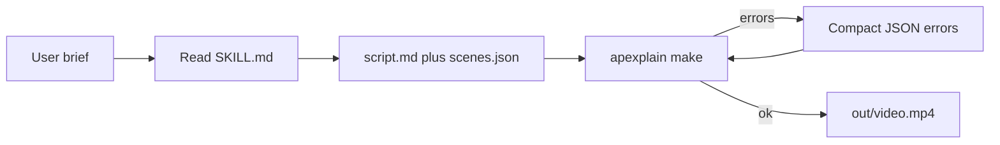
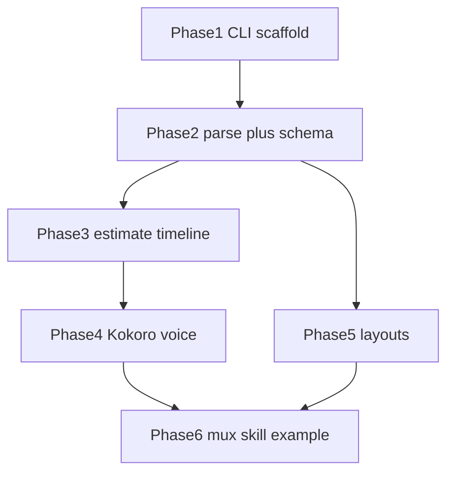

# Apexplain: phased token-cheap MVP

Agent-run explainer videos in the spirit of [explainroo](https://github.com/vincentsch/explainroo), designed so coding agents spend far fewer tokens: one ~2KB skill, declarative `scenes.json`, and a single `apexplain make` command.

This document is the product and implementation plan. Work is sequenced in six phases so each phase ships a usable CLI surface before the next capability is added.

## Implementation phases

- [x] **Phase 1** — CLI scaffold: init, docs, make --dry-run, doctor
- [x] **Phase 2** — script.md parser + scenes.json schema + compact path/rule errors
- [x] **Phase 3** — letter-rate duration estimate + synthetic sentence/marker timeline
- [x] **Phase 4** — Kokoro TTS, per-scene cache, measured chunk timeline
- [x] **Phase 5** — five-layout canvas engine + geometric layout check
- [x] **Phase 6** — ffmpeg mux, SKILL.md, leap-years example, golden tests

## Product target

Agent loop: read `SKILL.md` once → write `script.md` + `scenes.json` → `apexplain make` → MP4. No Whisper, no vision QA, no publish/record/AI clips.



### Token budget (vs explainroo)

| explainroo cost | Apexplain cut |
| --- | --- |
| AGENTS.md + many doc topics in context | One `skills/apexplain/SKILL.md` under ~2KB; extra docs only when `make` prints `read: apexplain docs <id>` |
| Agent writes `scenes.js` against a huge canvas API | Agent fills a schema: `layout: title \| cards \| steps \| compare \| flow` |
| Many CLI steps + still/sheet vision review | `make` = voice + layout-check + render; compact JSON errors |
| Per-word cues via Whisper | Cues are scene start / sentence index / `#marker` only |
| Agent opens PNGs to judge frames | Geometric layout check only; vision out of MVP |

### Project shape

```
videos/demo/
  video.json          # title, size 16:9|9:16, theme studio|dark
  script.md           # ## scene-id grammar (explainroo subset)
  scenes.json         # declarative layouts, not JS
  out/video.mp4
```

Example `scenes.json`:

```json
{
  "intro": { "layout": "title", "title": "Why leap years exist", "subtitle": "Calendars vs Earth's orbit" },
  "orbit": {
    "layout": "steps",
    "cue": "sentence",
    "items": [
      { "icon": "globe", "text": "365.2422 days per orbit" },
      { "icon": "calendar", "text": "365 days on the calendar" },
      { "icon": "clock", "text": "Drift of ~0.24 day per year" }
    ]
  }
}
```

`cue: "sentence"` reveals item *i* when sentence *i* starts. `#marker` in the script can override. No per-word `at`.

## Architecture choices

- **New Node ESM package** in this repo (`bin/apexplain.js`, `src/`), MIT, inspired by explainroo — do not vendor `stage.js` / `runtime.js` / the 40+ CLI commands.
- **Reuse ideas from explainroo** (script grammar, letter-rate length estimate, per-scene TTS cache, ffmpeg image2pipe mux). Copy small MIT helpers only when cheaper than rewriting.
- **Renderer: `@napi-rs/canvas` + system/bundled ffmpeg**, not Chrome/Playwright for v1. Five fixed layouts do not need a browser; this keeps `make` a single Node process. Chrome remains a later option if fidelity demands it.
- **TTS: Kokoro** via `kokoro-js` + `@huggingface/transformers`. Sentence/`#marker` cues get **exact** times by synthesizing one WAV chunk per sentence/marker boundary — Whisper stays out of MVP.
- **ffmpeg:** prefer system `ffmpeg` when present; fall back to `ffmpeg-static` so `make` works without a prior brew install.
- **Kokoro first-run download** (~hundreds of MB) is accepted for this token-first MVP. Agents trim length with `--estimate` / `--dry-run` before TTS when possible.

### Repo layout after Phase 1

```
package.json, bin/apexplain.js, src/cli.js
skills/apexplain/SKILL.md   # ~2KB agent skill
AGENTS.md                   # one-line pointer
templates/starter/          # video.json, script.md, scenes.json
examples/leap-years/        # golden example (scenes.json)
docs/apexplain-token-mvp.md # this plan
```

---

## Phase 1 — CLI scaffold + dry-run skeleton

**Goal:** `npx` / `node bin/apexplain.js` works; `init` creates a project; `make --dry-run` loads files and exits without TTS/render.

- Scaffold: `package.json` (`type: module`, `bin.apexplain`, engines `>=20.11`), `bin/apexplain.js`, `src/cli.js`, `src/errors.js` (`--json` exit shape).
- Commands: `init <dir>`, `docs [id]`, `make <dir> --dry-run`, `doctor` (Node + ffmpeg presence).
- `init` writes `video.json` (title, size `16:9|9:16`, theme `studio|dark`), starter `script.md`, starter `scenes.json`.
- **Exit criteria:** `apexplain init videos/demo` creates files; `apexplain make videos/demo --dry-run` prints “parsed N scenes” (even with stub parsers).

## Phase 2 — Script parser + scenes schema + compact errors

**Goal:** Invalid projects fail with machine-readable `path` + `rule` errors; valid ones parse cleanly.

- Port a **subset** of explainroo’s script grammar: `# title`, `## id {hold=…}`, `[#marker]`, `[pause]`, `{shown|spoken}`; ignore `>` notes and HTML comments. English only.
- Define `scenes.json` schema for five layouts: `title | cards | steps | compare | flow`. Scene ids must match script ids.
- Cue rules: scene-level `cue: "sentence"` (item *i* ↔ sentence *i*), optional per-item `at` (sentence index) or `marker`.
- Validate with AJV (or hand-rolled); errors like `{ "path": "scenes.json/orbit/items/2/text", "rule": "required" }`.
- Wire into `make --dry-run`: parse + validate, no estimate yet.
- **Exit criteria:** unit tests — bad `scenes.json` fails with path+rule; good starter project parses.

## Phase 3 — Duration estimate + sentence timeline (no audio yet)

**Goal:** Agents can trim scripts before TTS using letter-rate estimates (~12.7 letters/sec, same idea as explainroo).

- Implement `estimateLength` / `estimateLine` from script + `video.json` (lead/hold/end/pauses).
- Build a **synthetic timeline**: scene starts, sentence start times from letter proportions + pause rules, `#marker` → sentence-or-chunk start.
- `make --dry-run` / `make --estimate` prints length range and per-scene seconds; writes `build/timeline.json` (estimated).
- **Exit criteria:** leap-years-sized script estimates ~45–90s with a printed range; timeline has one entry per scene and per cue.

## Phase 4 — Kokoro TTS + voice cache + real sentence timeline

**Goal:** Real narration WAVs; cues locked to measured chunk durations.

- Lazy-load Kokoro (`onnx-community/Kokoro-82M-v1.0-ONNX`); cache under `~/.cache/apexplain/`. Weights are **not** in git — `setup:kokoro` or UI Settings download on demand.
- Split speech into chunks at sentence ends and `#marker` boundaries; synthesize per chunk; concatenate with pause silence; write `build/voice/<scene>.wav` + `.json` (hash of spoken text + voice + speed).
- Rebuild timeline from **measured** chunk durations (exact sentence/`#marker` times). Still no frames.
- CLI: `make <dir> --voice-only` stops after voice when render is not yet needed.
- **Exit criteria:** `make <dir> --voice-only` produces WAVs; re-run is a cache hit; timeline times match WAV lengths within ~50ms.

## Phase 5 — Five-layout engine + layout check

**Goal:** Declarative scenes draw correctly; geometric QA replaces vision.

- Small canvas engine (`@napi-rs/canvas`): theme colors, one type scale, Lucide **subset** icons (~30–40), safe margins for 16:9 and 9:16.
- Layout renderers: `title`, `cards`, `steps`, `compare`, `flow`. Reveal items by cue time (opacity/slide-in).
- Layout check: overflow, overlap, min type size → compact JSON errors (no PNG review loop).
- Optional: `preview` / single-frame PNG dump for debugging (not agent-required).
- **Exit criteria:** each layout renders a still PNG; intentional overflow fails with path+rule.

## Phase 6 — ffmpeg mux + skill + golden example + tests

**Goal:** End-to-end MP4 and the token product (skill).

- Capture frames at fps from the engine; pipe to ffmpeg (h264); mux voice; optional simple bed; hard-burn captions for 9:16; write `out/video.mp4` (+ srt optional).
- Single command: `apexplain make <dir>` = validate → TTS (cached) → layout-check → render → mux.
- Write `skills/apexplain/SKILL.md` (~2KB) and one-line `AGENTS.md`.
- Port `examples/leap-years` to `scenes.json` (no JS).
- Golden test: valid project → MP4 exists; invalid scenes → JSON with `path` + `rule`.
- Bump version / tag when this phase lands (next release after the `v0.0.1` plan-only tag).
- **Exit criteria:** `apexplain make examples/leap-years` exits 0 with `out/video.mp4`; skill alone is enough for an agent to repeat the flow.

---

## Post–Phase 6 language add

- `video.json` `"lang": "en" | "zh-HK"` (default `en`).
- English: Kokoro (local `~/.cache/apexplain`). zh-HK: external Vocello CLI only (Voice Design + Cantonese brief; no npm/Python Vocello dep) + TC fonts.
- Local web UI: `apexplain ui --port 3847`.

## Explicit non-goals until after Phase 6

Whisper/word cues, agent still/sheet vision, Rough.js/MathJax/camera director, paid TTS/images/clips, publish/share, product-demo `record`, Mandarin-as-Cantonese, motion blur, 54-voice catalog in the skill. Forking explainroo or matching its look frame-for-frame is also out of scope.

## Visual richness follow-ons (canvas, then Remotion-heavy)

Canvas layouts already cover the a2e §4 relations that fit `@napi-rs/canvas` without a full Remotion stack:

| a2e relation | Apexplain layout |
| --- | --- |
| Ordered process | `steps` / `flow` |
| Two lists / tradeoff | `compare` |
| Parts of a subject | `cards` |
| Big number | `stat` |
| Trend / curve | `chart` |
| Time axis / history | `timeline` |
| Source / takeaway line | `quote` |
| Funnel / filter | `funnel` |
| Merge / pipeline | `flow` (+ `nodes` / `stack` clipart) |

### Later phase — Remotion-heavy presentations (deferred)

Keep these for a dedicated later phase (after chrome / skill polish). They need richer motion, depth, or per-token animation that fights the token-cheap canvas MVP:

- [ ] **Point cloud / proximity** — grid plane + neighbor rings (a2e vector-space shots)
- [ ] **Tilted layers / depth planes** — skew/perspective stacks with path draw-on
- [ ] **Network / relation graph** — node light-up + edge draw-on + community rings
- [ ] **Formula token stream** — per-token reveal with result emphasis
- [ ] **LightSweep set-pieces** — multi-bar sweep + stage line + ghost text (a2e hero entrance; budget ≤2/film)

Until that phase, approximate with existing layouts (`cards`/`flow`/`stat`/`quote`) + clipart; do not invent Remotion-only JSON fields.

## Dependency map



Phases 4 and 5 can proceed in parallel after Phase 3 (voice and pictures are independent until mux).

## Suggested first execution slice

Start with **Phase 1 + Phase 2** only: runnable CLI, real parsers/schema, no model download. That gives a clear review point before committing to Kokoro and the renderer.
